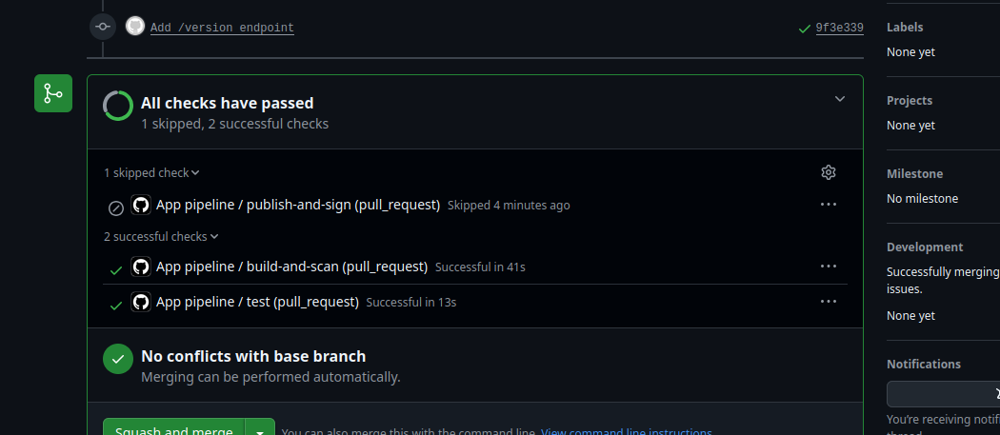
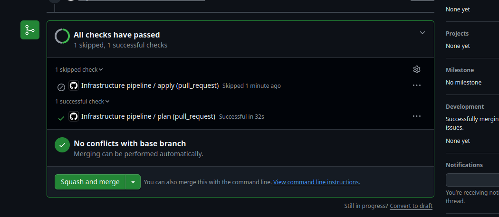

# separate-pipeline-demo

I built this to show, with working code, how I keep an application pipeline and an infrastructure pipeline apart. They have different triggers, different permissions, and they fail independently.

It is deliberately small. The app is a tiny Flask API and the infrastructure is one S3 bucket, because the point is the pipelines, not what they ship.

## The two pipelines

| | App pipeline | Infrastructure pipeline |
| --- | --- | --- |
| Workflow | `.github/workflows/app.yml` | `.github/workflows/infra.yml` |
| Runs when | Something under `app/` changes | Something under `infra/` changes |
| On a pull request | Unit tests with a coverage gate, image build, Trivy scan, SBOM, smoke test | `fmt`, `init`, `validate`, `plan`, with the plan shown in the run summary |
| On merge to `main` | Pushes the image to GHCR and signs it with Cosign | `apply` |
| Permissions | Read-only, except the publish job, which can write packages and request a signing identity | Read-only. It cannot publish or sign images |
| If a newer run starts | The old one is cancelled, since a build is safe to stop | The new one waits, since an apply should never be cut off halfway |

## Proof that they run separately

I made one change to each side and let GitHub show what ran.

An app-only pull request ([#5](https://github.com/onlygibson/separate-pipeline-demo/pull/5)) triggered only the app pipeline:

An infrastructure-only pull request ([#6](https://github.com/onlygibson/separate-pipeline-demo/pull/6)) triggered only the infrastructure pipeline:

## Why I keep them separate

- **They change at different speeds.** App code changes daily and infrastructure changes rarely. A one-line app fix should not re-run Terraform.
- **The risk is different.** A bad image can be rolled back. A bad apply can delete data. So infrastructure gets a plan that someone reads before anything changes.
- **Least privilege.** The app pipeline can push images but cannot touch infrastructure. The infrastructure pipeline cannot publish images.
- **Failures stay on their own side.** A failed scan does not block an infrastructure fix, and a failed apply does not block an app release.

I would not do this everywhere. For a small prototype with one environment, a single pipeline is simpler and fine. The split pays off as the team and the number of environments grow.

## What has to pass before an image is published

1. Unit tests, and the build fails below 80% coverage.
2. The image builds from a slim base, with OS security updates applied, pip removed and a non-root user.
3. A Trivy scan, which fails on fixable HIGH or CRITICAL vulnerabilities.
4. A CycloneDX SBOM is saved with the run.
5. A smoke test against the running container.
6. On `main` only: push to GHCR, then a keyless Cosign signature on the image digest.

## What Terraform manages

| Resource | Why |
| --- | --- |
| S3 bucket for build artifacts | Somewhere to keep SBOMs and similar outputs |
| Versioning | An artifact cannot be silently overwritten or deleted |
| KMS key with rotation, used to encrypt the bucket | Data is encrypted at rest with a key we control |
| Public access block | The bucket can never be made public |

## What I ran into

- **The first publish was refused.** Every layer uploaded, then GHCR answered `denied` on the final step. I read the log, re-ran only the failed job, and it passed unchanged. It was a one-off while the package was being created for the first time.
- **A container is not ready the instant it starts.** My first local `curl` got a connection reset. The pipeline now retries the health check instead of assuming the app is up.
- **Path filters and required checks do not mix well.** If I made the app pipeline a required check, infrastructure-only pull requests could never merge, because that check would never report. I left the checks not required and noted it below.

## Limits of this demo

- **Floci, not AWS.** Terraform runs against [Floci](https://github.com/floci-io/floci), a local AWS emulator, so the project needs no cloud account or secrets. It can behave differently from real AWS.
- **No saved state.** Each pipeline run starts a fresh emulator, so every plan shows all resources as new. On real AWS, remote state would show only what changed.
- **Nothing deploys the image.** The pipelines stop at a signed image and prepared infrastructure. A GitOps tool such as Argo CD would normally take it from there.
- **Development server.** The app uses Flask's built-in server. A production image would run behind a WSGI server such as gunicorn.
- **Checks are not required by the branch rule**, for the reason above. Direct pushes to `main` are still blocked, so every change goes through a pull request.

## What I would change for real AWS

1. Store Terraform state in a remote backend with locking.
2. Authenticate with OIDC instead of keys: a read-only role for `plan` and a write role for `apply`.
3. Put `apply` behind a GitHub environment with required reviewers.
4. Apply the saved plan that was reviewed, instead of planning again at apply time.

## Run it locally

App:

    cd app
    python3 -m venv .venv && source .venv/bin/activate
    pip install -r requirements-dev.txt
    pytest --cov=app
    docker build -t separate-pipeline-demo .
    docker run --rm -p 8080:8080 separate-pipeline-demo
    curl localhost:8080/health

Infrastructure (needs Docker and Terraform):

    docker run -d --name floci -p 4566:4566 floci/floci:latest
    cd infra
    terraform init
    terraform plan
    terraform apply

## Layout

    app/                           Flask API, tests, Dockerfile
    infra/                         Terraform for the platform side
    docs/                          Screenshots used in this README
    .github/workflows/app.yml      App pipeline
    .github/workflows/infra.yml    Infrastructure pipeline
